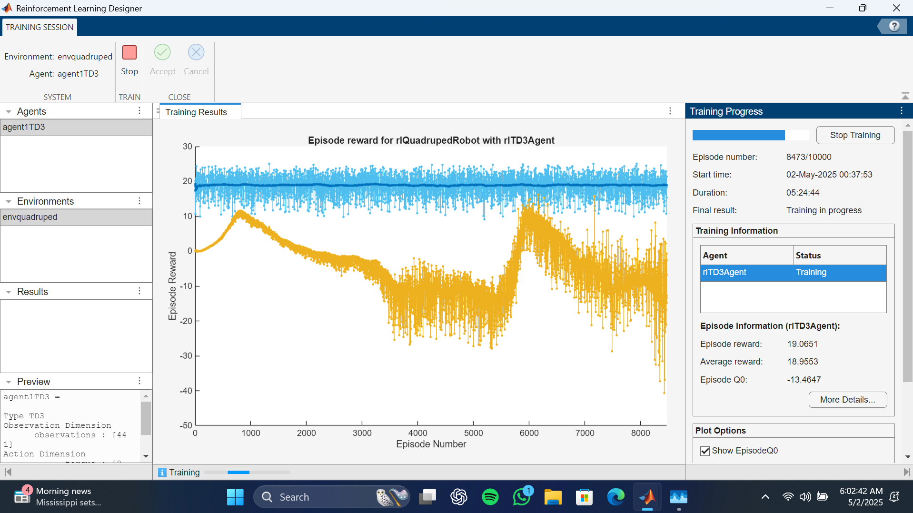

# Quadruped Locomotion with Deep Reinforcement Learning

**Yonatan Tamiru Asfaw  |  MATLAB / Simulink  |  TD3 and DDPG**

A quadruped locomotion project bringing together a Simscape robot model, reinforcement-learning policies, original training artifacts, network diagrams and a thesis report.

| Robot interface | Exported policy | Control sample time | Default episode |
| :---: | :---: | :---: | :---: |
| 44 observations / 8 actions | TD3 | 0.025 s | Up to 10 s |

## Start here

Download or clone this repository and set MATLAB's current folder to the repository root. Then run:

```matlab
run_demo
```

The launcher sets up paths and robot parameters, loads the supplied `agent1_Trained` policy, opens the model and runs one evaluation episode. **It does not start training.** An episode can end before 10 seconds when a model termination condition is reached.

The normal demo uses only the files in this repository. The large Designer workspace sessions are omitted from GitHub; they are not runtime dependencies.

### Required products

- MATLAB and Simulink
- Simscape and Simscape Multibody
- Reinforcement Learning Toolbox
- Deep Learning Toolbox

Parallel Computing Toolbox is optional for historical parallel-training workflows; the new training launcher uses serial execution by default. See [verification and reproduction notes](docs/REPRODUCIBILITY.md) for the exact validation scope and compatibility limits.

## Explore the project

| Location | What you will find |
| --- | --- |
| [`run_demo.m`](run_demo.m) | Evaluate the supplied trained TD3 agent |
| [`setup_quadruped.m`](setup_quadruped.m) | Configure paths, parameters, policy and environment |
| [`train_quadruped.m`](train_quadruped.m) | Explicitly start a fresh TD3 or DDPG training run |
| [`simulation/`](simulation/) | Simulink model, robot parameters, inverse kinematics and geometry helpers |
| [`src/`](src/) | Reset function, network construction and TD3 agent construction |
| [`agents/`](agents/) | Compact exported trained policy used by the demo |
| [`results/`](results/) | Original figures, training screenshots and network diagrams |
| [`media/`](media/) | Original project demonstration recordings |
| [`docs/thesis.pdf`](docs/thesis.pdf) | MSc thesis report |

## Original training progress

These are historical snapshots from the supplied archive, including intermediate runs. They are preserved as evidence of the development process; they are not new validation results and are not guaranteed to correspond to the exported policy checkpoint.



<details>
<summary>View the earlier training snapshot</summary>


</details>

## Demonstrations and saved results

- [Original demonstration recording 1](media/rl1.webm)
- [Original demonstration recording 2](media/rl3.webm)
- [Saved MATLAB figures](results/figures/)
- [Actor and critic network diagrams](results/networks/)

The `.fig` files can be opened with MATLAB `openfig`. The supplied speed/efficiency plots require care: an older script contains random placeholder data for those illustrations. They are retained for provenance and must not be treated as independently verified locomotion or energy benchmarks. No new performance claim is inferred from those plots.

## Train a new agent

Training is an explicit, potentially long operation:

```matlab
[td3Agent, td3Stats] = train_quadruped('td3', 1000);
% Or train a separate DDPG agent:
[ddpgAgent, ddpgStats] = train_quadruped('ddpg', 1000);
```

New checkpoints and statistics are saved under `generated/`. These launchers use reproducible settings for the supplied environment; they are not a claim that every historical reward curve can be recreated exactly. Use the original local Designer sessions when investigating the historical experiments.

## Download the complete selected package

A [project ZIP is available in Releases](https://github.com/yonatantamiru65-tech/DEEP-REINFORCEMENT-LEARNING-BASED-LOCOMOTION-CONTROL-FOR-QUADRUPED-ROBOTS-/releases/tag/project-artifacts-v1), containing the selected model, source, exported trained policy, original results, videos and thesis with their folder paths preserved.

The original archive's full Reinforcement Learning Designer workspace sessions are omitted to keep the upload compact. Three copies of one session were byte-identical; the separate DDPG-labelled full session is also much larger than the runtime policy. They remain in the original local archive for historical investigation.

## Source organization and attribution

The supplied Simulink model and exported policy are preserved unchanged. Helper files retain their MathWorks copyright headers where present. The plain `.m` reset function was converted from the supplied live function; setup and training adapters were added to make the project easier to launch.

Existing files under `matlab/` and the pre-existing unicycle notebook remain historical material. Use the root launchers above for the quadruped workflow; do not add the entire repository recursively to the MATLAB path, because duplicate historical helper names can shadow the curated files.

Generated `slprj` folders, Simulink caches, model backups and byte-identical session duplicates are excluded from the curated package. Original source archives remain unchanged. No blanket new license is assigned to third-party material.
